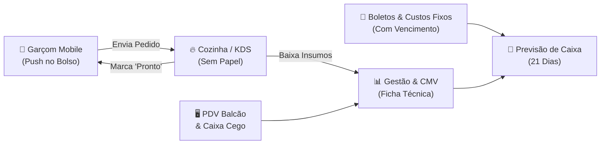

# NALIM Food Service — Apresentação Comercial para Donos de Restaurantes

> **Slogan:** *"Pare de apenas faturar alto e comece a ver o lucro real no seu bolso: controle sua operação, sua cozinha e seu fluxo de caixa em uma única plataforma integrada."*

---

## 1. O Cenário Atual: As 5 Maiores Dores do Dono de Restaurante

Muitos empresários do ramo de alimentação enfrentam diariamente o mesmo ciclo frustrante: **trabalham 14 horas por dia, a casa vive cheia, mas no fim do mês mal sobra dinheiro**. Isso acontece por cinco motivos principais:

1. **Ilusão do Faturamento Bruto:** O dono sabe quanto passou na máquina, mas não faz ideia do seu **Lucro Líquido Real** após descontar taxas do iFood (12% a 27%), taxas de maquininha de cartão e o CMV (Custo de Mercadoria Vendida).
2. **Surpresas no Fluxo de Caixa:** Os boletos de aluguel, energia e fornecedores vencem sem que haja uma previsão clara de quanto caixa haverá naquele dia específico, causando estresse e juros bancários.
3. **Comunicação Falha entre Salão e Cozinha:** Papéis de comanda amassados, pedidos esquecidos, comida esfriando na chapa porque o garçom não foi avisado a tempo.
4. **Custo Excessivo de Hardware:** Softwares tradicionais exigem que o restaurante compre maquininhas proprietárias ou tablets caros (R$ 800 a R$ 1.500 por aparelho) para cada garçom.
5. **Sangria Invisível com Desperdício:** Insumos caros (bacon, queijos nobres, carnes) são jogados fora ou mal porcionados sem nenhum registro de impacto no DRE.

---

## 2. A Solução: O Ecossistema NALIM Food Service

O **NALIM** não é apenas um emissor de pedidos. Ele é um **sistema integrado de gestão operacional e financeira** construído especificamente para a realidade de hamburguerias, restaurantes e deliveries.

---

## 3. O Grande Diferencial: Inteligência Financeira e Lucro na Ponta do Lápis

Diferente de sistemas comuns que apenas somam vendas, o NALIM calcula o **coração financeiro do seu restaurante**:

### A. CMV Automático e Margem de Contribuição por Prato
* Cada hambúrguer ou porção tem sua **Ficha Técnica grama a grama** (pão, carne, molho, embalagem).
* Ao vender um pedido, o sistema calcula na hora o **custo exato dos ingredientes** e mostra a margem limpa daquele item.

### B. Previsão de Fluxo de Caixa em Calendário de 21 Dias
* **Visão Antecipada de Liquidez:** Um calendário financeiro que projeta o saldo de caixa dia a dia pelas próximas 3 semanas.
* **Repasses Semanais de Apps:** Já calcula automaticamente as entradas do repasse do iFood e 99Food toda quarta-feira.
* **Custos Fixos e Boletos Integrados:** Aluguel, energia, contabilidade, gás e fornecedores cadastrados com dia de vencimento são automaticamente provisionados nas datas corretas.
* **Alerta Preventivo de Saldo Negativo:** O sistema avisa com dias de antecedência se haverá falta de caixa em determinada data, permitindo negociar prazos com fornecedores antes de entrar no cheque especial.

### C. DRE Simplificado e Ponto de Equilíbrio (Break-Even)
* Mostra claramente: **Receita Bruta ➔ (-) Taxas de Apps/Cartão ➔ (-) CMV ➔ (=) Lucro Bruto ➔ (-) Custos Fixos ➔ (=) Lucro Líquido Real**.
* Informa exatamente quantos pedidos ou quanto em dinheiro o restaurante precisa faturar por dia apenas para pagar os custos fixos.

### D. Fechamento de Caixa com Conferência Cega
* O operador de caixa fecha o turno sem ver o saldo do sistema. O gerente faz o confronto dos valores declarados (PIX, Dinheiro, Cartão), eliminando desvios e erros de troco.

---

## 4. Eficiência Operacional: Salão, Garçom e Cozinha em Harmonia

### A. Aplicativo do Garçom com Web Push no Celular (Sem Custo de Aparelhos)
* **Funciona no celular comum do garçom:** Sem necessidade de comprar maquininhas ou terminais caros.
* **Alerta no Bolso com a Tela Bloqueada:** Graças à tecnologia Web Push VAPID, quando o pedido fica pronto na cozinha, o celular do garçom vibra e toca um sinal sonoro imediatamente, mesmo com a tela apagada no bolso.
* **Mapa de Mesas Interativo:** Visualização em tempo real de mesas livres, ocupadas, tempo de permanência e pratos prontos aguardando retirada.
* **Personalização Rápida:** Adicione adicionais (bacon extra, cheddar) ou retire ingredientes ("sem cebola") com dois toques.

### B. KDS de Cozinha Digital (Adeus Comandas de Papel)
* Tela interativa na chapa dividida em três fases: **"Na Chapa"**, **"Pronto"** e **"Entregue"**.
* Cronômetro de tempo de preparo para evitar atrasos.
* Ao clicar em "Pronto", a cozinha dispara o aviso instantâneo para o salão sem precisar gritar pedidos.

### C. Delivery Próprio & Cardápio Digital (0% de Comissão)
* Cardápio responsivo e moderno para envio por link e redes sociais.
* Pedidos formatados enviados direto para o WhatsApp do restaurante.
* **Economia real:** Migrar 20% dos clientes do iFood para o canal próprio gera economia imediata de centenas a milhares de reais em taxas mensais.

---

## 5. Comparativo: NALIM vs. Softwares Tradicionais

| Funcionalidade | Softwares Tradicionais (Saipos, Totvs, Consumer) | NALIM Food Service |
| :--- | :---: | :---: |
| **Custo de Hardware** | Exige tablets ou POS proprietários (R$ 800+ cada) | **Zero.** Roda no smartphone Android da equipe |
| **Notificação Push em Tela Bloqueada** | ❌ Apenas aviso visual se o app estiver aberto | **✅ Sim.** Vibra e notifica com o celular bloqueado |
| **Previsão de Caixa com Boletos de Custos Fixos** | ❌ Cobrado em módulo financeiro avançado | **✅ Nativo.** Calendário de 21 dias com repasses iFood |
| **Cálculo de CMV Real por Ficha Técnica** | ❌ Complexo ou inexistente nas versões de entrada | **✅ Automático.** Atualiza a cada venda |
| **Fechamento de Caixa Cego** | ⚠️ Parcial | **✅ Completo.** Separação por operador e canal |
| **Comissão sobre Pedidos** | Alguns cobram % sobre o faturamento | **0% de comissão.** Mensalidade fixa e previsível |

---

## 6. Demonstração de Retorno Sobre o Investimento (ROI)

Em um restaurante ou hamburgueria média que fatura **R$ 45.000,00/mês**:

* **Redução de 3% no desperdício de insumos** via ficha técnica e controle de perdas: **+ R$ 1.350,00/mês economizados**.
* **Migração de apenas 15% dos pedidos do iFood para o Delivery Próprio:** **+ R$ 1.080,00/mês economizados em comissões**.
* **Agilidade no atendimento e giro de mesas:** Aumento de 10% na capacidade de atendimento em dias de pico: **+ R$ 2.200,00/mês de receita**.
* **Economia com compra de 3 terminais de garçom:** **+ R$ 2.400,00 (economia imediata)**.

> 💰 **Resultado:** O NALIM se paga nos primeiros 7 a 10 dias do mês e gera lucro líquido direto para o bolso do proprietário.

---

## 7. Roteiro Prático para Apresentação ao Dono (10 Minutos)

1. **Minutos 1 a 2 — A Pergunta Chave:**
   *"Seu negócio vende bem, mas hoje você sabe exatamente quantos reais líquidos sobraram no seu bolso depois de pagar o iFood, o cartão, a carne e os boletos da semana que vem?"*
2. **Minutos 3 a 5 — A Demonstração do Celular do Garçom:**
   * Abra o app do garçom no celular, lance um pedido de teste em 10 segundos.
   * Mostre o pedido aparecendo instantaneamente na tela da cozinha (KDS).
   * Marque como "Pronto" na cozinha e deixe o dono ver e sentir o celular apitar e vibrar com a tela apagada.
3. **Minutos 6 a 8 — O Painel Financeiro e Previsão de Caixa:**
   * Mostre o **Calendário Financeiro de 21 dias**.
   * Mostre como os boletos de luz e aluguel aparecem exatamente nos dias de vencimento e como o repasse da quarta-feira equilibra a conta.
   * Mostre a tela de **Saúde Financeira e Margem Real**.
4. **Minutos 9 a 10 — Fechamento:**
   * Apresente os planos mensais sem fidelidade abusiva e ofereça a implantação guiada do cardápio.
